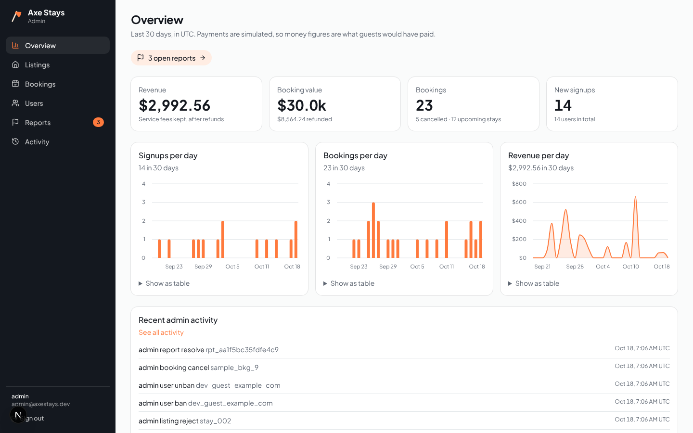

# Axe Stays Admin

The admin dashboard for [Axe Stays](../axe-stays): a Next.js 16 app with
shadcn/ui. It reads and writes the **same SQLite database** as the guest app,
so every change shows up in the app on the guest's next request.



More screenshots: [listings](docs/screenshots/2-listings.png), [users](docs/screenshots/3-users.png), [bookings](docs/screenshots/4-bookings.png), [reports](docs/screenshots/5-reports.png), [login](docs/screenshots/0-login.png).

## What admins can do

- **Overview:** signups, bookings, booking value and revenue for the last 30
  days, with a chart per measure (each also as a table), plus what needs
  attention: listings awaiting review and open reports.
- **Listings:** approve, reject (with a reason) or move back to review; create
  and edit every field, including photos (by URL or upload); delete listings that
  were never booked. Guests only ever see approved listings.
- **Bookings:** search and filter; cancel for a guest with a full refund or the
  stay's cancellation-policy refund, previewed before confirming.
- **Users:** search, filter by role and status, ban or unban with a reason, and
  change roles (guest, host, admin).
- **Reports:** the queue of listings guests reported from the app. Resolve,
  dismiss, or hide the listing and resolve in one step.
- **Activity:** every admin change: who, what, which record, when.

## Access control

Checked on the server, never only in the browser:

1. `src/app/(dashboard)/layout.tsx` sends signed-out visitors to `/login` and
   shows "No access" to signed-in non-admins and banned accounts.
2. Every page calls `pageAdmin()` and every server action calls `requireAdmin()`
   (`src/lib/auth.ts`), which read the session and then the user's role and ban
   status **from the database** on each request.
3. Every admin write in the shared data layer (`axe-stays/src/lib/db`) re-reads
   the acting user and refuses unless they're an active admin, so even a direct
   call with a stale or forged role fails.
4. Admins can't ban themselves, remove their own admin role, or remove the last
   admin.

Roles live in the database, not in Clerk. The first admin comes from
`ADMIN_EMAILS`: anyone signing in with a listed email is promoted.

## Run it

Start the guest app first (it creates the database). Then:

```bash
cd admin
npm install
cp .env.example .env.local     # set ADMIN_EMAILS, Clerk keys or AUTH_MODE=dev
npm run dev -- -p 3001         # http://localhost:3001
```

With `AUTH_MODE=dev`, sign in with an email from `ADMIN_EMAILS` (no password).

| Command | What it does |
| --- | --- |
| `npm run dev -- -p 3001` | Dev server |
| `npx tsc --noEmit` | Type check |
| `npm run lint` | Lint |
| `npm run build && npm start` | Production build |

## How it's wired

- Shared code is imported from the guest app through `tsconfig.json` paths:
  `@core/*` → `../axe-stays/src/lib/*` (data layer, pricing, validation) and
  `@brand` → `../axe-stays/src/brand.ts` (name, logo, colors). Turbopack's root
  is the repo root, so those files bundle normally.
- The database is `DATA_DIR/axe-stays.sqlite` (Node's built-in `node:sqlite`,
  Node 22.13+). Both apps open it in WAL mode, so they can read and write it at
  the same time.
- The theme's shadcn tokens come from `axe-stays/brand.config.js`
  (`src/components/brand-theme.tsx`), so a rebrand changes both apps.
- Pages render per request (Cache Components off): everything here is behind
  sign-in and reads live data.
